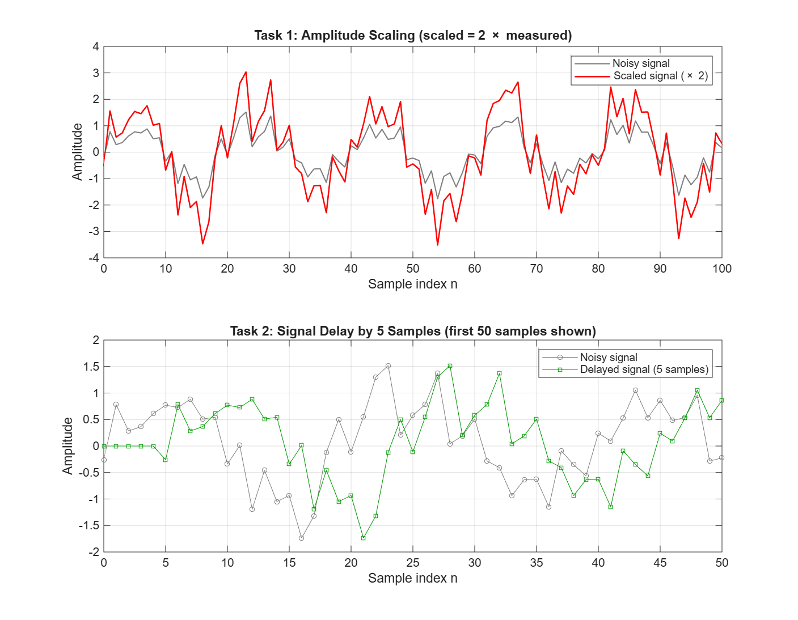
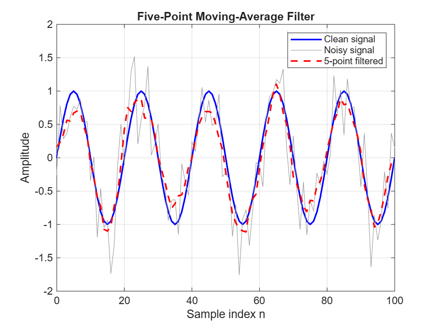
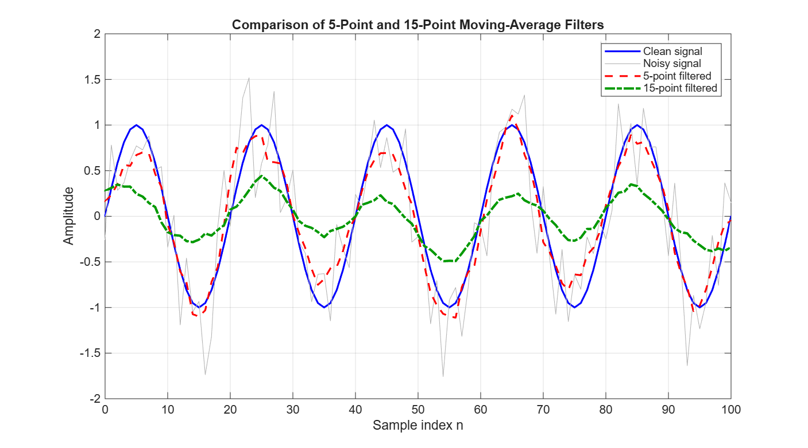

# Lecture 03 – Signal Operations, Convolution and Moving-Average Filtering

## Objective

In this assignment, I create a noisy discrete-time sine signal in MATLAB, apply two basic signal operations (amplitude scaling and delay), and reduce the noise with moving-average filters using convolution (`conv`). I then compare a 5-point and a 15-point filter to see how the filter length affects the result.

**How to run:** open `Lecture03_convolution.m` in MATLAB and press **Run**. The script runs from start to finish, saves the three PNG files and prints a numerical check in the Command Window.

## Files

| File | Description |
|------|-------------|
| `Lecture03_convolution.m` | MATLAB script for all tasks |
| `signal_operations.png` | Task 1 (amplitude scaling) and Task 2 (5-sample delay) |
| `noise_filtering.png` | Task 3 – clean, noisy and 5-point filtered signal |
| `filter_comparison.png` | Task 4 – 5-point vs 15-point filter |

The clean signal is `sin(0.1πn)` for n = 0…100. One period is 20 samples, so there are 5 full cycles. Gaussian noise with standard deviation 0.4 is added, and `rng(1)` makes the noise the same every run.

## Results

### Signal operations

### Noise filtering (5-point)

### Filter comparison (5-point vs 15-point)

### Numerical check (from the Command Window)

RMS error = how far a signal is from the clean signal on average (smaller is better). The first and last 7 samples are skipped because of the edge effect of `conv(...,'same')`.

| Signal | RMS error vs clean | Largest value (middle part) |
|--------|--------------------|-----------------------------|
| Clean | 0 | 1.00 |
| Noisy | 0.401 | – |
| 5-point filtered | **0.183** | 1.11 |
| 15-point filtered | 0.507 | 0.49 |

Other printed checks: max |scaled| / max |measured| = 2.0, and the length of measured = 101 while the length of delayed = 106.

## README Questions

**1. Which operation changed the signal amplitude?**
Amplitude scaling (`scaled = 2*measured`). Every sample is multiplied by 2, so the peaks became twice as high and the troughs twice as low. The noise was also doubled, because it is part of the measured signal. The frequency and the sample positions did not change: the peaks of the scaled signal are at the same n values as before.

**2. How did the five-sample delay change the signal?**
I made the delay by adding 5 zeros in front of the signal: `delayed = [zeros(1,5) measured]`. In the plot, the whole signal moved 5 samples to the **right**. Something that happened at n = 10 now happens at n = 15. The shape did not change at all; it is the same signal, just later. The delayed signal is 106 samples long instead of 101. In a real system, delay can come from sensor response time, data transmission over a network, buffering in a microcontroller, or the filter itself.

**3. What does the impulse response h[n] represent?**
h[n] is the output of the system when the input is a single impulse (1 at n = 0, 0 elsewhere). It completely describes a linear time-invariant (LTI) system. For the moving-average filter, `h5 = ones(1,5)/5` = [0.2 0.2 0.2 0.2 0.2]. This means each output sample is built from five input samples, each with a weight of 1/5.

**4. How did convolution change the noisy signal?**
Convolution slides h[n] along the noisy signal. At each position, it multiplies and sums, so every output sample is the average of its neighbouring samples. Random noise goes up and down from sample to sample, so it partly cancels out when averaged. The sine wave changes slowly, so it mostly stays. In `noise_filtering.png`, the red 5-point curve is much smoother than the grey noisy signal and follows the blue clean signal closely. The `'same'` option keeps the output at 101 samples and centres the filter, so the output is not shifted. At the first and last few samples, the filtered signal is slightly too small because `conv` assumes zeros outside the signal.

**5. What differences did you observe between the 5-point and 15-point filters?**
The 15-point output is much smoother: almost all the small jumps are gone. But it is also much **smaller**. Its largest value is only 0.49, while the clean signal reaches 1.00. So it lost about half of the signal. The 5-point output still has some small ripples, but it follows the clean signal closely. Its largest value is 1.11, slightly above 1, because a bit of noise is still left on top of the peaks. The reason is the length of the window. One period of the sine is 20 samples, so a 15-sample window covers 3/4 of a period. It averages the top of the wave together with samples that are already far down the slope, so the peaks get flattened. In theory, the gain of a moving-average filter at this frequency is about 0.90 for 5 points and about 0.30 for 15 points. My measured 0.49 is a bit higher than 0.30 because the remaining noise adds to the peaks.

**6. Which filter removed more noise?**
The 15-point filter removed more of the rapid random variation. Averaging more samples reduces random noise more: the noise standard deviation drops by about √N, from 0.4 to ≈ 0.18 for 5 points and ≈ 0.10 for 15 points.

**7. Did the longer filter remove or distort useful signal information?**
Yes. The 15-point filter removed a large part of the sine wave itself: the peaks dropped from 1.00 to only 0.49 in my figure. Its RMS error compared to the clean signal is **0.507**, which is even larger than the unfiltered noisy signal (0.401). So it is smoother, but it is less accurate than doing nothing. This is the excessive smoothing described in the assignment.

**8. Which filter would you recommend for this signal? Explain your decision.**
I recommend the **5-point filter**. It cut the RMS error by more than half (0.401 → 0.183) and kept the signal amplitude close to the real value, with the correct shape and timing. The 15-point filter looks cleaner, but it gives the wrong amplitude. In a measurement system, that is worse than a little leftover noise. As a rule, the filter window should be clearly shorter than one period of the signal you want to keep (here 5 vs 20 samples).

**9. Give one real engineering application for moving-average filtering.**
Smoothing sensor readings in an embedded or IoT system. For example, averaging the last few samples from a temperature or vibration sensor before showing them on a dashboard or using them to trigger an alarm. This prevents single noisy readings from causing false alarms. Other examples are smoothing GPS speed readings or ECG signals.

## AI Usage

**Tool used:** Claude (Anthropic)

**How I used it:**
I gave Claude the assignment text and asked it to help me complete the MATLAB tasks and write the explanations. It suggested the code for scaling (`2*measured`), delay (`[zeros(1,5) measured]`), the plots, and a numerical RMS-error check that prints in the Command Window. It also explained why the 15-point filter reduces the amplitude (the window covers most of one 20-sample period). I then ran the script myself and gave it my own results, so the numbers in this README come from my MATLAB run.

**What I verified or changed:**
- Ran the script in MATLAB Online from start to finish without errors, and checked that all three PNG files were created.
- Checked the Command Window output: scaled/measured ratio = 2.0, and the delayed signal is 106 samples long (101 + 5).
- Checked in the delay plot that the delayed signal starts with 5 zeros and is shifted 5 samples to the right.
- Compared my RMS error values (0.401, 0.183, 0.507) with the filter comparison figure. The 15-point curve is visibly much smaller than the clean signal, which matches its higher error.
- Calculated the expected noise reduction by hand: 0.4/√5 ≈ 0.18, which matches my 5-point result of 0.183.
